<picture>
  <source media="(prefers-color-scheme: dark)" srcset="assets/banner-dark.svg">
  
</picture>

I'm doing an MSc in Finance at CUHK, with a background in wealth management: KYC and onboarding, client portfolios and return modelling. I build small tools for the finance problems I run into, mostly in Python, SQL and plain HTML.

I'm looking for operations, middle office and finance analyst roles in Hong Kong.

### Projects

**[PrimeOps Replay](https://github.com/souvik-guha/primeops-replay)** · [project page](https://souvik-guha.github.io/primeops-replay/)  
Reconciles client trade allocations against broker executions, as of any moment in the day. Python and SQL.

**[Portfolio Allocation Visualizer](https://github.com/souvik-guha/portfolio-allocation-visualizer)** · [live](https://souvik-guha.github.io/portfolio-allocation-visualizer/)  
Turns an allocation into return, volatility, VaR and expected shortfall, with correlation between assets. One HTML file, works offline.

**[CUHK MSc Finance GPA Calculator](https://github.com/souvik-guha/CUHKMfinGPA)** · [live](https://souvik-guha.github.io/CUHKMfinGPA/)  
Course scores, the final-exam mark you need, and unit-weighted GPA. Every figure is checked against an exact reference.

[LinkedIn](https://www.linkedin.com/in/souvik-guha/) · Hong Kong
